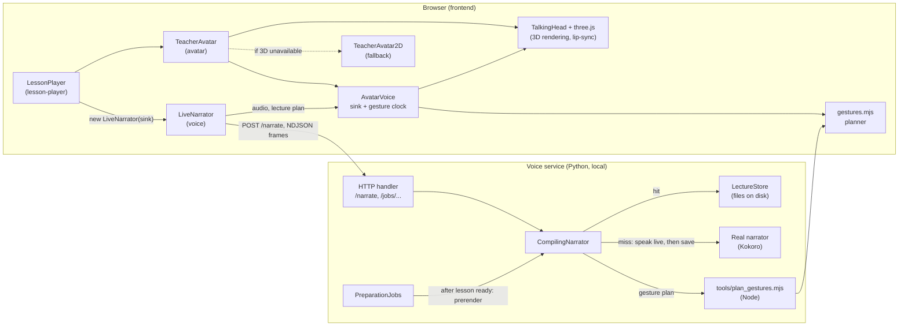
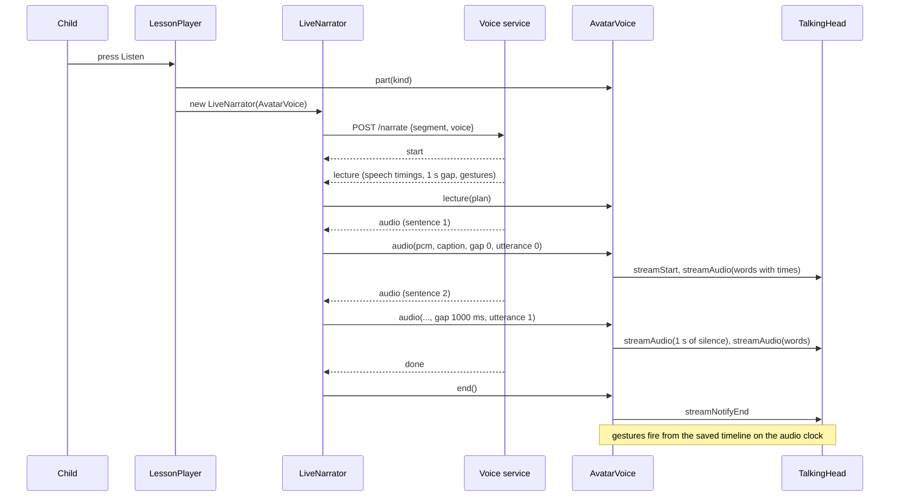
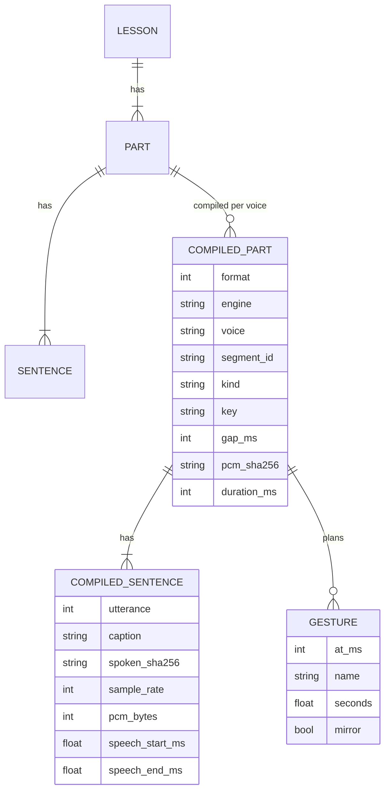
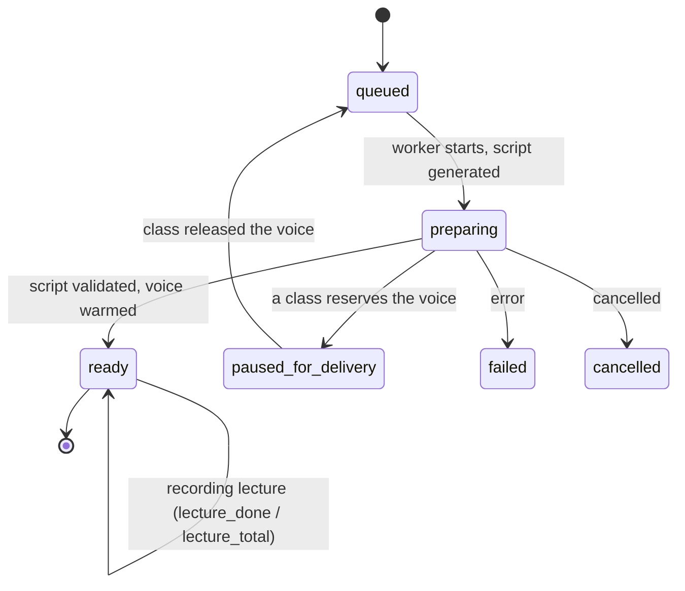

# Edaptive: the talking teacher avatar and compiled lectures

**FYP-1 Mid Evaluation support document (Form 2 demo and Form 3 report)**
Track B (front-end, avatar and voice). Branch `avatar-dev`, commits `2305dfb`, `2236e90` and `7d570af`, 15 Oct 2026.

> **How to use this document.** It is written so that sections can be lifted straight into the mid report and used as a
> demo script. Section 0 maps the rubric to sections. Anything marked **[TO FILL]** is team information only the team
> knows (names, panel actions, iteration plan). Anything marked **[NOT VERIFIED]** was implemented but not exercised;
> do not claim it as tested. Every number in this document was measured or counted in this repository; the
> measurement method is in section 8.

---

## 0. Rubric map

### Form 2 (presentation and demo)

| Form 2 criterion | Where in this document | Honest status |
|---|---|---|
| 1. Previous proposal actions addressed | **[TO FILL]** from the Panel Action Register | Not covered here. |
| 2. Iteration plan and work breakdown progress | Section 14 (what was done, in what order) | Fill in planned versus actual dates. |
| 3. Live prototype with core module demo (25) | Sections 9 and 10 (demo script, failure cases) | Strong; two rehearsal items are marked. |
| 4. Requirements and acceptance criteria (10) | Section 4 | Numbered, each with an acceptance check and status. |
| 5. Design artefacts and design evolution (15) | Sections 5 and 6 | Diagrams match the committed code; decisions and rejected options explained. |
| 6. Repository, milestone and member evidence (10) | Section 14 | **Risk: both commits are under one git identity. See 14.3.** |
| 7. Testing and early validation (10) | Section 8 | 29 new automated tests, mutation-checked, plus browser measurements; failure cases discussed. |
| 8. Presentation, Q&A, team and tool ownership (10) | Sections 11 and 12 | Walkthrough notes and Q&A prepared; tool disclosure in section 12. |

### Form 3 (report)

| Form 3 criterion | Where |
|---|---|
| 2. Problem formulation, R&D and gap analysis | Sections 1 and 3 |
| 3. Project vision, scope and success criteria | Sections 1, 2 and 4 |
| 4. Requirements and acceptance criteria | Section 4 |
| 5. Architecture and component/interface design | Section 5 |
| 6. Data / process / behaviour design | Section 6 |
| 7. Implementation documentation | Section 7 (files, algorithms, setup, decisions) |
| 8. Testing plan and tool / risk disclosure | Sections 8, 12 and 13 |

---

## 1. Summary

Edaptive is an offline, local-model homeschool tutor for Grades 1 to 5. A lesson is a list of **parts** (hook,
lecture, worked example, transition, question, "watch out", recap), and each part is a list of sentences that the
teacher speaks.

Before this work the lesson player showed the sentence text and played a synthetic voice. There was no teacher on
screen, and every sentence was synthesised by the voice model **while the child waited** ("The teacher is getting
ready to speak"). This work added:

1. **A talking teacher** beside the lesson text: a 3D character (with a 2D cartoon fallback) whose mouth follows the
   words being spoken, who blinks, keeps eye contact and stands steadily.
2. **A male and a female teacher** that follow the existing "Teacher voice" dropdown.
3. **Natural pacing:** a 1 second pause between sentences, with the mouth shut during the pause.
4. **Gestures that go with what is said** (wave to begin, pointing for "look", a thinking pose for questions, thumbs up
   for praise, and so on), chosen from the lesson part type and the sentence text.
5. **Compiled lectures:** the narration, pauses, speech timing and gestures are recorded ahead of class on one
   timeline and played back as saved, so a part starts almost at once instead of waiting for the voice model.

All of it runs in the browser or on the local machine: no cloud service is needed at class time and no GPU is needed.

**Headline result** (stand-in voice, software-rendered headless browser; see section 8.4): first sound arrives after
**79 ms on average (348 ms worst case) over 38 compiled parts, against 1.6 to 4 seconds when spoken live**; click to
speaking dropped from **3.9 s to 0.7 to 1.2 s**.

---

## 2. Scope and fit with the proposal

The project rules (`AGENTS.md`) freeze scope to the accepted proposal and list **`avatar`**, **`voice`** and
**`lesson-player`** as Track B features. This work is entirely inside those Track B areas. It adds no new learning
feature, stores no child data, and adds no paid or cloud service to the product.

| Project rule | How this work respects it |
|---|---|
| Offline only, no paid APIs, CDNs or remote fonts at runtime | The 3D engine (three.js) and avatar library (TalkingHead) are bundled by npm; models are local files. Compiled lectures are local files. **One deviation, during development only: see 12.3.** |
| Verification first / LLM only in the Socratic engine | Untouched: this work does not call an LLM. |
| Children's data stays minimal; attention processing stays in the browser | Compiled lectures hold teacher audio and lesson text only. No learner identity, audio or video is stored. |
| Only change your own track's folders | Edits are in Track B folders plus `Makefile`, `.github/CODEOWNERS` and `frontend/next.config.ts`. **These need Track B (Amna) review before merge.** |

---

## 3. Background, related work and design gap

This section is the starting point for the Form 3 R&D criterion. **Add proper citations before submitting**; the
sources below are real and were consulted, but the supervisor will expect you to explain them in your own words.

**Problem.** A tutor for young children needs a face and a rhythm. A voice alone is less engaging, and a long wait
before each sentence breaks attention. The system must also work offline on a family's ordinary computer, which
usually has no NVIDIA GPU.

**Approaches to making an avatar talk, and why each was or was not used:**

| Approach | What it is | Used? | Why |
|---|---|---|---|
| Audio-driven neural facial animation (NVIDIA **Audio2Face-3D**, Chung et al., arXiv 2508.16401) | A network turns audio into face movement | **No** | Its SDK needs an NVIDIA GPU with CUDA 12.8 and TensorRT, and a 3D character with a blendshape rig. The development machine has an Intel GPU only, and a typical home computer is similar. See 6.4. |
| **Viseme-based lip-sync** with a 3D character (**TalkingHead**, MIT) | Words become mouth shapes (visemes) that drive blendshapes on a rigged 3D model | **Yes (3D teacher)** | Runs in a browser on the CPU or any GPU, no model download, offline. |
| **Audio-level driven 2D mouth** | The loudness and brightness of the audio open and shape a drawn mouth | **Yes (fallback)** | Needs nothing but the browser and the cartoon image. |
| TTS that reports word timings | The TTS says when each word starts | **No** | The narration stream carries one audio chunk per sentence and no word times, so word times are estimated from word length (limitation L5). |

**Gap this work addresses.** The existing player had no visual teacher, no pacing between sentences, and synthesis at
class time. The contribution is the combination: a teacher that works on commodity hardware offline, plus a
**compile-ahead pipeline** that makes the voice, pauses, mouth timing and gestures agree and removes the wait.

**Standards and sources used:** ARKit face blendshapes (52 shapes, Apple); Oculus lip-sync visemes (15 shapes, Meta);
Mixamo-compatible skeleton (Adobe); glTF 2.0 / GLB model format (Khronos); TalkingHead by Mika Suominen
(github.com/met4citizen/TalkingHead, MIT); three.js (MIT); Kokoro-82M TTS (the project's voice).

---

## 4. Requirements and acceptance criteria

Each requirement has an acceptance check and its verification status. "Verified" means observed or measured as
described in section 8. IDs are for use in the SRS.

### 4.1 Functional requirements

| ID | Requirement | Acceptance check | Status |
|---|---|---|---|
| FR-1 | The lesson pages (`/lesson-preview`, `/lesson-demo`, scheduled class) shall show a teacher beside the lesson text. | The teacher is visible, the whole figure is in frame, and the lesson text and controls remain usable. | Verified (screenshots, 1100 px window). |
| FR-2 | The teacher shall match the selected voice: a female voice shows the female teacher, a male voice shows the male teacher. | Changing the dropdown replaces the model; a "Changing teacher…" note shows while loading; if the new model fails, the current teacher stays. | Switch verified (female to male to female, one canvas, no errors). Failure-keeps-current **[NOT VERIFIED]** in a browser. |
| FR-3 | The teacher's mouth shall move with the words spoken. | Mouth shapes change in step with the speech in captured frames. | Verified visually; mouth movement on the female model is subtle (L3). |
| FR-4 | There shall be a pause of 1 second between sentences, and the mouth shall be shut during it. | Scheduled gap is 1.00 s; silence at the avatar's audio output is at least 1 s; no mouth shapes are scheduled in the gap. | Verified: 1.00 s scheduled gaps; 1.4 to 1.6 s silences at the output (the 1 s plus TTS padding). |
| FR-5 | The teacher shall make gestures that fit the lesson part type and the sentence text. | The planner gives each part an opening gesture and text-cue gestures; a lesson's hook opens with a wave on "Your mission starts today". | Verified on the real lesson: 88 gestures over 86 sentences; wave and open-hand sweeps seen in frames. |
| FR-6 | The teacher shall keep a steady standing pose and not change stance on her own. | No stance change over 85 s idle and during speech. | Verified. |
| FR-7 | Pause, resume, replay, next-part and stop shall work with the avatar. | Pause freezes sound, mouth and gestures; resume continues in step; replay and next restart cleanly. | Verified in the browser (no console errors); "frozen audio" itself not separately measured. |
| FR-8 | If WebGL or the 3D model is unavailable, a 2D teacher shall be shown and the sound shall still play. | The 2D teacher appears and speaks. | 2D teacher verified. Missing-model and no-WebGL paths implemented, **[NOT VERIFIED]** in a browser. |
| FR-9 | A lesson's narration shall be compiled ahead of class and played back as saved. | After preparation, parts are compiled for both voices; at class time the first sound arrives without synthesis. | Verified with a stand-in voice (section 8.4); **[NOT VERIFIED]** with real Kokoro. |
| FR-10 | Compiled audio shall never be played for a script that has changed. | Editing a sentence causes a miss, and the old file is not served. | Verified by unit tests (mutation-checked). |
| FR-11 | A damaged compiled file shall be ignored and the part spoken live. | Truncated, altered or unreadable files are rejected. | Verified by unit tests. |
| FR-12 | Recording shall never block or delay a class. | When a class starts, recording stops within one sentence, and the finished lesson is not paused or re-prepared. | Verified by unit tests with fakes; **[NOT VERIFIED]** on a real Kokoro run. |
| FR-13 | A part that is not compiled yet shall still play, and be saved for next time. | First play is live and identical to before; second play is instant. | Verified. |
| FR-14 | A rigged model that is missing required data shall be repairable, or rejected with a clear reason. | The preparation tool fixes names, missing gaze shapes and the root name, and refuses a model without a skeleton or mouth-sound shapes. | Verified on both supplied models and on a non-GLB. |

### 4.2 Non-functional requirements

| ID | Requirement | Acceptance check | Status |
|---|---|---|---|
| NFR-1 | Offline and no GPU needed at class time. | 3D teacher renders in a software-rendered browser (no GPU); no network request at class time except to the local service. | Verified for rendering. Network behaviour checked in code, not by packet capture. |
| NFR-2 | Responsiveness: a compiled part starts quickly. | First sound after the request within 500 ms. | Verified: 79 ms average, 348 ms worst over 38 parts. |
| NFR-3 | Privacy: no child data in compiled lectures. | Files contain only teacher audio, lesson text, timings. | Verified by inspection of the file format (section 7.7). |
| NFR-4 | Robustness: failures degrade to the previous behaviour. | Compile failure, missing Node, damaged cache all leave narration working. | Verified by unit tests. |
| NFR-5 | Portability: Windows and macOS. | Same code path; Node and Python only. | Windows verified; **macOS [NOT VERIFIED]** (guide for Amna in `docs/voice/TEACHER_AVATAR.md`). |
| NFR-6 | Maintainability: one set of gesture rules. | The browser and the compiler run the same file. | Verified (`gestures.mjs`, Node test). |
| NFR-7 | Accessibility basics. | Teacher has an accessible name; reduced-motion respected; the current sentence stays highlighted. | Implemented; not audited with assistive technology. |
| NFR-8 | Storage bounded. | Compiled lectures are capped (default 4 GB) with least-recently-used removal. | Verified by a unit test. About 21 MB for a 19-part lesson in both voices. |

---

## 5. Architecture and component / interface design

### 5.1 Component view



**Layering and interfaces.** Features talk to each other only through their `index.ts` (the repository's boundary
rule). The two cross-feature interfaces added are small and typed:

| Interface | Between | Contract |
|---|---|---|
| `NarrationSink` | `LiveNarrator` (voice) and `AvatarVoice` (avatar) | `part(kind)`, `lecture(plan)`, `audio(pcm, rate, caption, gapBeforeMs, utterance)`, `end()`, `stop()`, `pause()`, `resume()`. The narrator keeps time for captions; the sink plays the sound. |
| NDJSON narration stream | Voice service and browser | Existing frames `start`, `audio`, `done`, plus one new `lecture` frame (7.6). An older client ignores it. |
| `CompilingNarrator` | Handler and real narrator | Same interface as the real narrator (`frames`, `lock`, `warm`, `release`), so `service.py`'s handler did not change. |
| `plan_gestures.mjs` | Python and the JavaScript planner | JSON on stdin, JSON on stdout. |

### 5.2 Playback sequence (compiled part)



### 5.3 Compile sequence (after a lesson is prepared)

```mermaid
sequenceDiagram
  participant J as PreparationJobs
  participant CN as CompilingNarrator
  participant K as Kokoro
  participant PG as Node planner
  participant S as LectureStore
  J->>J: script validated, voice warmed
  J->>J: mark job ready and not running
  J->>CN: prerender_lesson(lesson, voices, should_stop)
  loop each voice, each part
    CN->>CN: skip if already compiled
    CN->>K: frames(segment, voice)
    K-->>CN: start, audio..., done
    CN->>PG: kind, sentence timings
    PG-->>CN: gesture plan
    CN->>S: save (audio, timeline)
  end
  Note over J,CN: should_stop is true as soon as a class reserves the voice; the loop ends within one sentence
```

---

## 6. Data, process and behaviour design

### 6.1 Data design: the compiled part

Two files per part and voice, in `<job store>/lectures/<engine>/<voice>/`:

* `<part>-<key>.json` is the timeline (example in section 7.6).
* `<part>-<key>.pcm` is the raw 16-bit mono audio of all sentences, concatenated.

`key` is the first 24 hex characters of a SHA-256 over: the format number, a fingerprint of the gesture rules, the voice
engine, the voice, the part id and every sentence's spoken text and caption. **Editing a sentence, changing the voice or
the engine, or editing the gesture rules changes the key, so old audio (or gestures planned by old rules) can never be
found for new text or new rules.**



All times are milliseconds on **one clock** that starts at the first sentence's audio and includes the 1 second gaps.

### 6.2 Behaviour: job lifecycle with recording



The design point is the `ready -> ready` self-step: **recording happens after the job is already `ready` and is no longer
`running`.** `reserve()` (class start) pauses whatever job is `running`; if recording ran while the job was still
`running`, a class starting mid-recording would flip the finished job to `paused_for_delivery` and the whole lesson
would be prepared again. This trap was found by reading `reserve()` and is covered by a test (section 8.2).

### 6.3 Behaviour: how one sentence is played

1. The narrator receives a sentence's audio. It decodes it to 16-bit PCM.
2. **Gap:** if this is a new sentence (not a later chunk of the same one), the gap is 1000 ms (from the plan if present).
3. **Narrator clock:** the narrator schedules the sentence no earlier than `previous end + gap`, so captions advance
   in step. When the avatar plays the sound, the narrator's own output is muted (gain 0) and only keeps time.
4. **Avatar:** `AvatarVoice` sends 1 s of silence (if a gap applies), then the sentence with word timings that cover only
   the part where she is really speaking.
5. **Gestures** fire when the audio clock reaches their time; the clock stops while paused.

### 6.4 Rejected designs and why (design evolution)

| Option | Outcome | Evidence |
|---|---|---|
| NVIDIA **Audio2Face-3D SDK** for lip-sync | Rejected | Needs an NVIDIA GPU (CUDA 12.8, TensorRT) and a 3D blendshape rig as input to its solver (its documentation); the development PC has only Intel Iris Xe. |
| **Kokoro on Windows via MLX** | Rejected | The Windows `mlx` wheel lacked `mlx.dll` (fixed by the `mlx-cpu` package), but on this CPU the model took 275 s to load and **119 s to speak one 2-second sentence**; a first lesson part had not finished after 10 minutes. |
| Windows built-in voices (SAPI) | Used briefly | Instant and offline, but robotic; replaced by Edge voices as a development stand-in. |
| **Edge neural TTS** | Used as a development stand-in | Natural; but online (see 12.3) and occasionally returns nothing, so retries were added. |
| 2D photo with a drawn mouth | Replaced | Looked wrong on a photograph; works well on a flat cartoon, so it became the fallback. |
| Public-folder compiled audio served by Next.js | Rejected | It would bypass the server's gating (unreviewed lessons must not start a class). Serving through the voice service keeps that gate. |
| Browser-only caching (IndexedDB) | Rejected | Not shared across machines/browsers, not controlled by the lesson-preparation flow. |
| Porting the gesture rules to Python | Rejected | Two copies drift apart. Instead the planner is plain JavaScript run by both the browser and Node. |
| Planning gestures live in the browser only | Kept as the fallback | Used when a part is not compiled or Node is missing. |

---

## 7. Implementation documentation

### 7.1 What was added or changed

| File | Purpose |
|---|---|
| `frontend/src/features/avatar/TeacherAvatar.tsx` | The 3D teacher: loads TalkingHead and the model for the selected voice, holds the stance, falls back to 2D, switches models live. |
| `frontend/src/features/avatar/avatar-voice.ts` | `AvatarVoice`: plays narration through TalkingHead, builds word timings, inserts silence for the gaps, runs the gesture clock, uses a compiled plan if present. |
| `frontend/src/features/avatar/gestures.mjs` (+ `gestures.d.mts`) | The gesture planner (plain JavaScript so Node can run it too). |
| `frontend/src/features/avatar/TeacherAvatar2D.tsx` | The 2D cartoon fallback with an audio-driven mouth. |
| `frontend/src/features/avatar/talkinghead.d.ts` | Types for the parts of TalkingHead that are used. |
| `frontend/src/features/avatar/avatar.module.css`, `index.ts`, `types.ts`, `README.md` | Styles (stage size, change note), public exports, phase type, folder README. |
| `frontend/src/features/voice/live-narrator.ts` | Added: `NarrationSink`, `LecturePlan`, the 1 s gap, reading and validating the `lecture` frame, chunk handling. |
| `frontend/src/features/lesson-player/LessonPlayer.tsx` (+ CSS) | Places the teacher beside the text, passes the selected voice, passes the part type. |
| `frontend/src/lib/voice-preview-api.ts` | Type for the new `lecture` frame. |
| `frontend/next.config.ts`, `frontend/build-tools/talkinghead-loader.cjs` | Build fix: TalkingHead's runtime `import()` of its lip-sync files cannot be bundled by Turbopack; the loader marks it as a runtime import (never reached). |
| `voice_service/lecture.py` | `LectureStore`, `CompilingNarrator`, speech bounds, planner call, rules fingerprint, pruning. |
| `voice_service/jobs.py`, `voice_service/service.py` | `record_lecture` hook after a lesson is ready; flags `--lecture-store`, `--lecture-max-gb`, `--no-lecture-cache`. |
| `voice_service/test_lecture.py` | 29 tests. |
| `tools/plan_gestures.mjs` | Node entry point to the planner for the compiler. |
| `tools/dev_demo/` (`run.py`, `serve.py`, `windows_voice.py`, `edge_voice.py`) | Development demo with sound: stand-in voices plus compiled lectures, launched with one command. |
| `tools/qa/` (`check_teacher.py`, `measure_lecture.py`, `_cdp.py`) | The browser check and the timing measurement used for section 8. Headless browser, software 3D, no GPU. |
| `tools/prepare_avatar_glb.py` | Repairs a rigged GLB for TalkingHead (standard library only). |
| `docs/voice/TEACHER_AVATAR.md`, `voice_service/README.md` | Run guide for the Apple Silicon / Kokoro setup and the compiled-lecture description. |
| `.gitignore`, `.github/CODEOWNERS`, `Makefile`, `frontend/package.json` + lockfile | Ignore zips and stray models (the two teacher models are committed on the snapshot branch only); Track B ownership of new paths; run the new tests in `make check`; two new npm dependencies. |

Size: about 2,200 lines added across 33 files in two commits (`git diff --stat`, lockfile excluded). Key files: `lecture.py` 348 lines, `test_lecture.py` 414, `avatar-voice.ts` 190, `TeacherAvatar.tsx` 163, `gestures.mjs` 144, `live-narrator.ts` 171.

### 7.2 External dependencies added (and why)

| Package | Version | Licence | Why |
|---|---|---|---|
| `@met4citizen/talkinghead` | 1.7.0 | MIT | The avatar library: lip-sync from words to mouth shapes, blinking, eye contact, gestures, streaming audio. |
| `three` | ^0.180.0 | MIT | TalkingHead's only dependency (3D rendering). |
| `@types/three` (dev) | ^0.180.0 | MIT | Types for the above. |

### 7.3 Key algorithms

**Speech bounds** (`speechBounds` in TypeScript, `speech_bounds` in Python, same rule). TTS pads each sentence with
silence. Samples quieter than 700 (about 2% of full scale) count as silence. Scan inward from both ends; the first and
last loud sample give the speech start and end. This is what keeps the mouth shut in the padding.

**Word timing.** The sentence's words are spread across the speech span only, each word weighted by `length + 2`. TalkingHead
turns each timed word into mouth shapes with its English rules. (Estimated, not read from the TTS: limitation L5.)

**Timeline offsets.** For a part with sentences `0..n`: `offset = 0`; for each sentence, if it is not the first,
`offset += 1000` (gap); the sentence's speech starts at `offset + speech_start`; then `offset += audio duration`. Gestures
and word times use this same clock. The browser and the Python compiler compute it the same way so the saved gesture times
line up with the audio.

**Gesture planner** (`gestures.mjs`), in order of priority:

1. The first sentence of a part gets that part type's opening gesture (7 part types; each has 1 to 3 options that take turns).
2. Otherwise the first of 15 text rules that matches (greetings, praise, "careful", "look", questions, "maybe", "first/next", ...).
3. Otherwise, a rotating gentle "beat" from 5 options, except every 4th unmatched sentence is left still.
4. A sentence longer than 4.5 s gets a second gesture around its middle.

Constraints: at least 2.5 s between gestures; never the same gesture twice in a row; sentences under 1.1 s are skipped; left and right
hands alternate; **only gestures that keep the mouth closed are used**. A `seed` (derived from the part id when
compiling) starts the rotations in different places so parts vary.

**Cache key and integrity.** Key: SHA-256 of `[format, rules fingerprint, engine, voice, part id, [spoken, caption] per sentence]`; the fingerprint is a hash of `gestures.mjs` and `tools/plan_gestures.mjs`.
On load: format and key match; same number of sentences; each sentence's caption and `spoken_sha256` match the current
script; sizes are even, positive and add up to the `.pcm` size; the audio's SHA-256 matches; gestures pass range checks.
Any failure means "not compiled" and the part is spoken live.

**Atomic write.** The `.pcm` is written to a temporary name and renamed into place first, then the `.json`. A reader
only trusts a part once its `.json` exists, so it never sees audio without a timeline.

**Superseded files.** Saving a part deletes that part's older compilations (changed script or changed rules). It matches the exact
`<part>-<24 hex>.json|.pcm` names, so another part whose id merely starts the same way is never touched (a unit test guards this,
and fails if the match is loosened to a prefix).

**Pruning.** Above the size cap, parts (a `.json` and `.pcm` pair) are removed oldest-use first (`os.utime` is touched
on every read).

**Recording loop** (`prerender_lesson`). For each voice and part: stop if asked; skip if compiled; take the narrator's
lock for **one part only** (2 s timeout, give up if busy); speak the part through the real narrator, checking
`should_stop` between frames; if stopped, save nothing for that part. `should_stop` is true as soon as `reservation_until`
is in the future (a class reserved the voice).

### 7.4 TalkingHead API used (verified against the installed 1.7.0 source)

`new TalkingHead(node, options)`; `showAvatar({url, body, avatarMood, lipsyncLang})`; `streamStart(options, onAudioStart)`;
`streamAudio({audio, words, wtimes, wdurations})` (16-bit PCM, word times in ms from the start of the stream);
`streamNotifyEnd()`; `streamInterrupt()`; `stopSpeaking()`; `playGesture(name, seconds, mirror, ms)`; `stopGesture(ms)`;
`playPose(name, null, seconds)`; `start()`; `stop()` (also suspends/resumes its audio clock); `dispose()`. Options used:
`lipsyncModules: []` (English is registered by hand), `pcmSampleRate: 24000`, `cameraView: "mid"`, `cameraDistance: 1`,
`avatarMood: "happy"`. The npm 1.7.0 differs slightly from GitHub `main` (`showAvatar` has no preprocess callback), so the code targets 1.7.0.

### 7.5 What the 3D model must contain, and the repair tool

A rigged full-body GLB with: a Mixamo-compatible skeleton (about 67 to 68 bones, root `Armature`); the 52 ARKit blendshapes
and the 15 mouth-sound shapes (`viseme_sil`, `viseme_PP`, ... `viseme_U`); and shape **names** in `mesh.extras.targetNames`.

`tools/prepare_avatar_glb.py` reads the GLB (it never modifies the source) and: copies shape names from accessor labels if
the exporter left them there; adds any missing ARKit shape as an empty shape (zero movement) so TalkingHead's eye-gaze
lookups never fail; renames the root node to `Armature`. It **stops with a clear message** if the skeleton or the mouth-sound
shapes are missing, because those cannot be invented.

| Model | Source | Needed |
|---|---|---|
| Female teacher (tweed suit, glasses) | "Teacher Female Narration 01", a Babylon.js export | Names copied from accessors; 9 empty shapes (eye gaze, tongue) added; root renamed. |
| Male teacher | `mechar.glb`, a Blender export | Names already present and root already `Armature`; only the 9 empty shapes. |

Both then have 72 blendshapes and 67 skeleton joints.

### 7.6 Wire format and file example

NDJSON stream (one JSON object per line). `lecture` is new; the rest existed.

```
{"type":"start","segment_id":"s_0004"}
{"type":"lecture","version":1,"gap_ms":1000,"kind":"transition",
 "sentences":[{"utterance":0,"speech_start_ms":132.4,"speech_end_ms":1149.3},
              {"utterance":1,"speech_start_ms":132.8,"speech_end_ms":4514.9}],
 "gestures":[{"at_ms":3005,"name":"<ok sign emoji>","seconds":2.2,"mirror":true}]}
{"type":"audio","utterance":0,"caption":"Now it is your turn.","sample_rate":24000,"pcm_s16le":"<base64>","ready_after_s":0.0}
{"type":"audio","utterance":1,"caption":"How would you explain this idea: Ten-frame: 9 and 1 make 10?", ...}
{"type":"done","segment_id":"s_0004"}
```

The browser checks the `lecture` frame field by field (`readPlan`): gap within 0 to 5000 ms, finite speech times,
gesture names non-empty and at most 16 characters, durations within 0.1 to 10 s. A frame that fails is ignored and the part is
planned live.

The saved timeline file for the same part (hashes shortened):

```json
{
  "format": 1, "engine": "edge-tts-neural-v1", "voice": "af_heart",
  "segment_id": "s_0004", "kind": "transition", "key": "018e4eab3d1a...", "gap_ms": 1000,
  "sentences": [
    {"utterance": 0, "caption": "Now it is your turn.", "spoken_sha256": "94f391572c24...",
     "sample_rate": 24000, "pcm_bytes": 89856, "speech_start_ms": 132.4, "speech_end_ms": 1149.3},
    {"utterance": 1, "caption": "How would you explain this idea: Ten-frame: 9 and 1 make 10?",
     "spoken_sha256": "4221b32b9961...", "sample_rate": 24000, "pcm_bytes": 232704,
     "speech_start_ms": 132.8, "speech_end_ms": 4514.9}
  ],
  "gestures": [{"at_ms": 3005, "name": "<ok sign emoji>", "seconds": 2.2, "mirror": true}],
  "pcm_sha256": "c9333064e451...", "duration_ms": 7720
}
```

### 7.7 Privacy review of what is stored

Stored: teacher audio (synthetic), the lesson sentence text, timings, gesture names. Not stored: any child identifier,
child audio, video, answers, or progress. The files live outside git (job store). Test hooks (`window.__audio`,
`window.__gestures`, `window.__head`) only receive data if a test has created those arrays first.

### 7.8 Setup and reproduction

**Prerequisites:** Node 20.9 or newer (tested on 24.14), Python 3.11 or newer, the repository, and for the 3D teacher two
rigged GLBs. The GLBs are **not** in the repository (large, separately licensed); without them the 2D teacher is shown.

```sh
# 1. install (adds three and TalkingHead)
cd frontend && npm install

# 2. prepare the models (once per model)
python tools/prepare_avatar_glb.py "Female Teacher.glb" frontend/public/avatars/teacher.glb
python tools/prepare_avatar_glb.py "Male Teacher.glb"   frontend/public/avatars/teacher-male.glb

# 3. checks
cd frontend && npm run lint && npm run typecheck
python -m unittest voice_service.test_lecture            # 29 tests

# 4a. the development demo: sound, both 3D teachers, compiled lectures (offline Windows voice by default on Windows)
python tools/dev_demo/run.py --prerender                 # then open http://127.0.0.1:3001/lesson-demo and press Listen
#     --voice edge uses online neural voices instead (pip install -r tools/dev_demo/requirements.txt)
# 4b. browser check of the teacher (headless, no GPU needed; pip install aiohttp)
python tools/qa/check_teacher.py --male --reach
python tools/qa/measure_lecture.py --store tools/dev_demo/lectures/windows-sapi-v1
# 4c. the full system with real Kokoro on Apple Silicon: docs/RUN_CURRENT_SYSTEM.md
#     python3 tools/run_local_application.py --allow-draft-lessons
```

Compiled lectures need no setup: the voice service wraps the narrator by default. Flags: `--lecture-store DIR`,
`--lecture-max-gb N` (default 4), `--no-lecture-cache`. To start clean, delete `<job store>/lectures/`.

**Reproducibility.** Everything used for the demos and measurements is in the repository: `tools/dev_demo/` (the stand-in voices and
the launcher) and `tools/qa/` (the browser check and the timing measurement). The numbers in section 8.4 can be regenerated with them.
The stand-in voices are development tools only (12.3).

---

## 8. Testing and validation

### 8.1 Test plan

| Layer | What is tested | How |
|---|---|---|
| Unit (Python) | Speech bounds, store round trip, integrity and staleness, narrator wrapper, recording loop, job-runner hook, Node planner | 27 tests in `voice_service/test_lecture.py`, fake voice and temp folders, no real TTS |
| Static | Lint, types, production build | `npm run lint`, `npm run typecheck`, `npm run build`; `ruff` on new Python |
| Regression | Existing tests unaffected | 149 repo tests (`tests/`), existing voice tests |
| Browser behaviour | Rendering, lip-sync, pacing, gestures, switching, pause/resume | Headless Edge driven over the DevTools protocol (software 3D), screenshots and in-page measurements |
| Performance | Time to first sound, live versus compiled | Timed requests through the real frontend proxy; in-page timers |
| Failure cases | See 8.5 | Unit tests and live checks |

### 8.2 The 29 automated tests

| Group | Test | Checks |
|---|---|---|
| Speech timing (2) | finds speech inside the padding | Speech found within 15 ms of the true start and end. |
| | all silence is one span | No crash on silent audio. |
| Saved files (12) | round trip serves the part with its timeline | Audio byte-for-byte equal; frames `start, lecture, audio..., done`. |
| | gestures are on one clock with the gap | Second sentence's gesture time = first sentence's audio + 1000 ms + lead-in. |
| | editing the script never plays old audio | Changed text is a miss. |
| | another voice or engine is a different part | No sharing across voices or engines. |
| | damaged files are ignored | Truncated, one-byte-changed (same size) and unreadable files are rejected. |
| | tampered sentence text is ignored | Timeline edited to mismatch is rejected. |
| | changing the gesture rules recompiles | A part planned by older rules is not served. |
| | recompiling removes superseded files and only those | Old files for the same part are deleted; parts whose names start the same way are untouched. |
| | nonsense gestures on disk are rejected | A 999-second gesture is rejected. |
| | no planner still compiles the audio | Gestures saved as null; browser plans live. |
| | ids with dots and odd characters are safe | `../../escape` cannot write outside the store. |
| | the store keeps to its size | Oldest part dropped first. |
| Narrator wrapper (9) | first play is live and is saved | Same frames as the voice produced; second play does not call the voice. |
| | unfinished part not saved | Replay or leaving mid-part saves nothing. |
| | failed narration not saved | An error frame prevents saving. |
| | chunks of one sentence become one sentence | Chunks merged into one sentence. |
| | everything else belongs to the real narrator | Lock and `warm` pass through. |
| | prerender compiles all parts and voices, skips done ones | 2 parts x 2 voices = 4 calls; second run does nothing; lock free after. |
| | prerender stops when a class starts, keeps finished parts | Stop honoured; completed parts kept. |
| | prerender stops between sentences, saves nothing partial | A part stopped mid-way is not saved. |
| | prerender does not wait on a busy teacher | Gives up after a 2 s lock timeout. |
| Job runner (4) | ready lesson gets its lecture recorded and stays ready | Job not `running` during recording; voice still held; progress fields written. |
| | a class reserving the voice stops the recording | Run with a real thread; the finished job stays `ready`. |
| | a failing recording never fails the lesson | Exception swallowed; job `ready`. |
| | without a recorder nothing changes | Behaviour as before. |
| Planner under Node (2) | the browser's planner runs under Node | Hook part gets a wave at the right time. (Skipped without Node.) |
| | Node failure means no plan, not a crash | Missing Node returns "no plan". |

### 8.3 Mutation checking (do the tests catch real mistakes?)

Three safeguards were deliberately broken and the suite re-run:

| Deliberate break | Result |
|---|---|
| Drop the gap from the timeline | Caught by the gesture-clock test |
| Remove the audio integrity check | Caught by the damaged-files test |
| Remove the per-sentence text check | **Not caught at first** (the file name already hashes the text), so a test for a tampered timeline was added; now caught |

### 8.4 Measurements

Environment: Windows 11, Intel Iris Xe (no NVIDIA GPU), Python 3.11, Node 24.14, Edge headless with **software** 3D
(SwiftShader), Edge neural voices as a stand-in for Kokoro. The browser is slower than a real machine, so browser times are
an upper bound.

| Measurement | Result |
|---|---|
| Offline Windows voice (the committed default demo): compile all 38 parts | 27 s; first sound compiled **71 ms average, 222 ms worst**; one part live 623 ms against 61 and 90 ms compiled (this voice is much faster than the online one) |
| Compile the whole demo lesson with the online Edge voice (19 parts x 2 voices) | First run 190 s; a second full recompile (after editing the gesture rules) 93 s, because the stand-in voice service's speed varies. 38 parts, 76 files, **21.3 MB** |
| First sound after the request, compiled (all 38 parts through the frontend proxy) | **79 ms average, 348 ms worst** |
| First sound after the request, spoken live (same part, removed from the store) | 1.6 s (earlier runs 2.2 to 3 s) |
| Click to speaking in the browser, live | **3.9 s** (request itself took 4.0 s) |
| Click to speaking in the browser, compiled | **0.7 s and 1.2 s** in two runs |
| Scheduled gap, 2D teacher | 1.00 s |
| Silence at the 3D avatar's audio output between sentences | 1.4 to 1.6 s with the online voice, about 2 s with the offline Windows voice (the 1 s gap plus each voice's own leading and trailing padding) |
| Gesture timing | Fired 18 to 216 ms before the planned sentence start in the three gestures measured (by design a gesture may start up to 250 ms early, so the hand is moving when she begins) |
| Gestures over the real lesson (86 sentences) | 88 gestures, about one per sentence; types: 27 open hand, 18 smile, 14 point, 11 thinking, 8 slight smile, 8 OK, 1 wave, 1 thumbs up |
| Stance stability | Same stance for 85 s idle and through speech |
| Model switch (headless) | Indicator at 0.6 s; new model in place by 5.2 s |
| Reach | Arm outstretched either side and raised hand fit the 460 px stage, both teachers |

### 8.5 Failure and edge cases

| Case | Handling | Evidence |
|---|---|---|
| Voice returns nothing (Edge TTS flakiness) | Retry up to 5 times with back-off | Seen live; first sentence once took 14 s |
| Voice splits one sentence into chunks | Compiler merges chunks; live player no longer adds a gap inside a sentence | Unit test; found by reading the Kokoro narrator |
| Script edited after compile | Hash mismatch, old audio never served | Unit test (mutation-checked) |
| Cache file corrupted or truncated | Rejected, spoken live | Unit test |
| Node not installed | Audio still compiled; browser plans gestures live | Unit test |
| Class starts during recording | Recording stops within one sentence; finished job not paused | Unit test with a thread |
| Recording crashes | Swallowed; lesson stays ready | Unit test |
| Compile cannot save (disk error) | Swallowed; narration unaffected | Code path (`_save`), not separately tested |
| Cache grows large | LRU pruning at 4 GB (default) | Unit test |
| Model missing or WebGL unavailable | 2D teacher, sound still plays | 2D teacher verified; the missing-model path **[NOT VERIFIED]** in a browser |
| New model fails to load during a switch | Current teacher stays | **[NOT VERIFIED]** in a browser |
| Old browser tab after a restart | Shows "Getting the lesson ready…" forever (stale scripts) | Hard refresh fixes it; documented |

### 8.6 Not tested (state this openly)

Real Kokoro on Apple Silicon (including the recording hook inside the real job flow); a real GPU; Safari and Firefox; assistive
technology; a formal listening test (sound was checked informally by the developer through real speakers); testing with children; long-running memory
use; concurrent classes.

---

## 9. Demo script (about 8 to 10 minutes)

Pre-demo: both models in `frontend/public/avatars/`, the voice service and frontend running, a lesson compiled, a browser
window at least 1100 px wide, volume checked, **a normal browser window (not an IDE preview)**, hard refresh after any restart.

| Step | Do | Say | Expect |
|---|---|---|---|
| 1 | Open `/lesson-demo`, press **Listen**. | "Before, there was no teacher and every sentence waited on the voice model." | Wave on the first sentence (the hook always opens with one), mouth moves, 1 s breathing pauses, highlighted sentence advances. |
| 2 | Point at a pause. | "The mouth is shut between sentences because no words are scheduled there." | Mouth closed in the gap. |
| 3 | Let a few parts play. | "Gestures come from the part type and the words: point for 'look', thinking for questions." | Different gestures; hands alternate. |
| 4 | Switch the dropdown to **Male teacher**. | "The teacher follows the voice." | "Changing teacher…" then the male model; press Listen: he speaks and gestures. |
| 5 | **Pause**, then **Keep listening**. | "Sound, mouth and gestures stop and resume together." | Frozen then in step. |
| 6 | **Replay this part** mid-sentence. | "Replay clears the queue; nothing is left over." | Clean restart. |
| 7 | Show the compiled folder; point at `.json` and `.pcm`. | "This is the lecture recorded ahead of class: audio, speech timing, pauses, gestures on one clock." | Two files per part per voice. |
| 8 | **Failure case A:** delete one part's two files, press Listen on it. | "A part that is not compiled is spoken live, like before, and saved." | Slower start (seconds); replay it: instant. |
| 9 | **Failure case B:** change one byte in a `.pcm`. | "A damaged file is rejected, never played." | Spoken live. |
| 10 | Run `python -m unittest voice_service.test_lecture -v`. | "29 tests; I broke three safeguards on purpose to prove they catch mistakes." | `OK`. |
| 11 | **Rehearse first:** rename `teacher.glb` and reload. | "If the model is missing, the 2D teacher takes over and the sound still plays." | 2D cartoon appears. **[NOT VERIFIED]: try it before the demo.** |

Edge cases to mention if asked: chunked sentences, Node missing, class starting mid-recording (unit-tested), voice returning
nothing (retries).

---

## 10. Walkthrough notes (be ready to explain code live)

The supervisor may ask you to explain new code at function level. For each, know **what it does, why, and what breaks if removed.**

| Code | What it does | If removed or wrong |
|---|---|---|
| `LiveNarrator` gap: `starts = max(cursor + gap/1000, now + 0.04)` | Never schedules a sentence closer than 1 s after the previous | Sentences run together; no breathing space. |
| `readPlan` | Validates the compiled frame field by field | A damaged frame could feed nonsense (negative times, huge durations) to the avatar. |
| `AvatarVoice.audio` | Sends silence for the gap, then the sentence with word times | Mouth would move through gaps, or lip-sync would drift. |
| `speechBounds` / `speech_bounds` | Finds where speech starts and ends inside a sentence | Mouth moves during TTS padding. |
| `wordTimings` | Spreads words across the speech span by length | Lip-sync would be spread over padding, off beat. |
| `GesturePlanner.plan` | Opening gesture, cue gestures, beats, second gesture on long sentences, spacing | No gestures, or gestures piling up or repeating. |
| `LectureStore.key` / `_read` | Text-hash key and integrity checks | Stale or damaged audio could be played. |
| `LectureStore.save` | Writes audio first, then the timeline | A reader could find audio with no timeline. |
| `CompilingNarrator.frames` | Hit: stream the file. Miss: speak live, collect, save when complete | Either no speed-up, or half-parts saved. |
| `prerender_lesson` | Records every part, lock held per part only, stops on `should_stop` | A class could wait on a long recording. |
| `PreparationJobs.record_lecture` | Marks the job not running, then records | A class starting mid-recording would pause the finished job and re-prepare the lesson. |
| `talkinghead-loader.cjs` | Marks one `import()` as runtime-only | The 3D library cannot be bundled and the page fails to compile. |
| `prepare_avatar_glb.py` | Fixes names, adds empty gaze shapes, renames root | TalkingHead throws "Blend shapes not found" or crashes in its eye animation. |
| `STANCE` + `playPose(..., 10_000_000)` | Holds one pose by postponing the idle pose changes | She switches stance every 5 to 30 s (hand on hip and so on). |

---

## 11. Problems met and how they were solved

This log is evidence of engineering process and gives you failure stories to discuss.

| # | Problem | Cause | Fix |
|---|---|---|---|
| 1 | Demo crashed on Windows reading the lesson | `read_text()` without an encoding reads cp1252 | Run Python in UTF-8 mode (`PYTHONUTF8=1`); proper fix is `encoding="utf-8"` in `voice_service/service.py:21` (Track B). |
| 2 | Curriculum files failed their SHA-256 check | Git's `autocrlf` rewrote them with Windows line endings | Convert in place; set `core.autocrlf=input` for the repo. |
| 3 | Curriculum files missing on disk | Sparse checkout excluded `ciriculam/` | Disabled sparse checkout. |
| 4 | Real Kokoro unusable on this PC | Windows `mlx` wheel lacked `mlx.dll`; after installing `mlx-cpu` it was ~57x slower than real time | Abandoned for Windows; stand-in voices for development. |
| 5 | Silent demo | The portable demo has no sound without a Mac recording | Stand-in voices. |
| 6 | Edge TTS sometimes returned nothing | Intermittent service behaviour | Retries with back-off. |
| 7 | Page compiled with an error | TalkingHead's `import(moduleName)` cannot be bundled by Turbopack | Build-time loader marks it runtime-only; English lip-sync registered by hand. |
| 8 | "Blend shapes not found" on the supplied female model | Exporter put names in accessor labels, not `targetNames` | Repair tool copies them. |
| 9 | Crash in the avatar's animation loop | Missing eye-gaze ARKit shapes | Tool adds empty shapes. |
| 10 | Avatar posed (hand on hip, shifting) | TalkingHead picks random stances every 5 to 30 s | Hold one stance for a very long duration. |
| 11 | Gestures could open the mouth in the gaps | Some face emojis use the jaw | Only closed-mouth gestures are used. |
| 12 | Outstretched arm clipped | Stage too narrow (320 px) | Stage 460 px, camera pulled back. |
| 13 | Suit lady missing; placeholder shown | The default file was still the sample | Female model installed as the default. |
| 14 | A pause inside long sentences with Kokoro | Kokoro can return several chunks per sentence; gap applied per chunk | Gap only on new sentences; compiler merges chunks. |
| 15 | Finished job could be re-prepared | `reserve()` pauses the `running` job | Mark ready and not running before recording. |
| 16 | A test safeguard was untested | Mutation check showed it | Added the tamper test. |
| 18 | A lesson's hook could open with a thumbs up, not a wave | Opening gestures rotate by a per-part seed; found while measuring a compiled run | The hook now always opens with a wave. |
| 19 | Compiled gestures would not follow a change to the gesture rules | Saved plans were keyed only by text, voice and engine | A fingerprint of the rules is now part of the key, so editing the rules recompiles. Checked live: after the change all 38 parts recompiled on their own and the hook's saved first gesture became a wave. |
| 20 | Old compiled files piled up after a rule change (152 files, 41 MB) | Nothing removed superseded entries until the size cap | Saving a part removes its superseded files, matching exact names so neighbouring parts are safe (tested, mutation-checked). |
| 17 | Ten existing job tests reported errors on Windows | Their cleanup cannot delete a SQLite file that is still open (Windows file locking) | Confirmed it predates this work, and that all 10 pass when the cleanup problem is neutralised (see L9). |

---

## 12. Tool, dependency and AI disclosure (required)

### 12.1 Generative-AI assistance

**This work was developed with an AI coding assistant (Claude Code, by Anthropic), used throughout** to read the codebase and
the TalkingHead source, write and refactor the code, write the tests, run measurements and write the documentation. The
assistant also used web search to look up library facts and model names. **You must be able to explain and defend everything here
as your own work.** Section 10 is for that. Suggested disclosure text for the report:

> AI-assisted development: an AI coding assistant (Claude Code) generated and modified code, tests and documentation for the
> teacher avatar and compiled-lecture features under the student's direction. The student reviewed the output, ran the tests and
> measurements, and is responsible for the work. Outputs were checked against library source code, automated tests and
> in-browser measurements; limitations are listed in section 13.

**[TO FILL]** who directed the work, who reviewed which parts, and anything you changed yourself.

### 12.2 Third-party software and assets

| Item | Use | Licence | In the repository? |
|---|---|---|---|
| TalkingHead 1.7.0 | Avatar lip-sync and animation | MIT | npm dependency |
| three.js | 3D rendering | MIT | npm dependency |
| Female teacher GLB ("Teacher Female Narration 01") | Female 3D teacher | Author: **LasquetiSpice**, credited in `frontend/public/avatars/CREDITS.md`. **Licence terms not confirmed: [TO FILL]** | Yes, on the snapshot branch `track-b/teacher-avatar-snapshot` (git-ignored on `avatar-dev`) |
| Male teacher GLB (`mechar.glb`) | Male 3D teacher | Author: **pendekaralahmad**, credited in `frontend/public/avatars/CREDITS.md`. **Licence terms not confirmed: [TO FILL]** | Yes, on the snapshot branch `track-b/teacher-avatar-snapshot` (git-ignored on `avatar-dev`) |
| Cartoon teacher image | 2D fallback | Supplied by the developer, who said they generated it. **[TO FILL] the tool used and the rights** | Yes (`teacher.webp`, 55 KB) |
| TalkingHead sample avatars | Early placeholders, removed | Mostly CC BY-NC (non-commercial) | No |
| Kokoro-82M | The project's voice | Per project docs | No (external model) |

Many 3D marketplaces and avatar services forbid delivering their models inside a public web app, because the file reaches the
browser. Confirm the licence of both teacher models allows this before any public release.

### 12.3 Online services used **during development only** (deviation from "offline only")

| Service | Use | Where it lives |
|---|---|---|
| Microsoft Edge neural voices (`edge-tts` package) | A natural-sounding stand-in voice, because the real Kokoro voice cannot run on the Windows development PC at usable speed | `tools/dev_demo/edge_voice.py`: a development tool, **not part of the product**; needs internet |
| Windows built-in voices (SAPI) | An **offline** stand-in voice | `tools/dev_demo/windows_voice.py`: a development tool, not part of the product |
| OpenAI API (a few test calls: listing models, trying reasoning-effort values, one text generation) | Tried as a stand-in for the local language model during an early experiment; no lesson was generated with it | Local scratch only; key in a git-ignored `.env`; no OpenAI code in the repository |

The product's voice is Kokoro, which is local. Lecture files record the **engine** in their key, so audio from a stand-in
voice is never mixed with Kokoro audio.

### 12.4 Risk register

| Risk | Impact | Mitigation |
|---|---|---|
| Real Kokoro behaves differently (speed, chunking, padding) | Recording slow, or timings off | Guide and checklist for the Mac; compiler merges chunks; silence threshold is one constant. |
| Recording competes with a class for the voice | A class could wait | Stops within one sentence; per-part lock with timeout; tested. |
| Model licences | The two models are publicly downloadable from a public repository without confirmed licence terms | Authors are credited. **Confirm the licence at the source; remove or replace the files if it does not allow redistribution** (git history keeps them, so removal needs history cleanup). |
| Disk use | Large cache | Cap with LRU pruning; about 21 MB per lesson for both voices. |
| Gestures feel wrong to children | Distracting | Rules are data in one file; tune; **not tested with children**. |
| Gestures unsuitable for some cultures | Offence or confusion | Review the gesture list (the namaste gesture is not used). |
| One person's commits dominate | Uneven contribution evidence | See 14.3. |
| Test hooks in production code | Surface area | Inert unless a test creates the arrays; could move behind a build flag. |

---

## 13. Known limitations

| # | Limitation |
|---|---|
| L1 | Not verified with real Kokoro or on Apple Silicon; the recording hook inside the real job flow is tested with fakes only. |
| L2 | Verified in a software-rendered headless browser; not on a real GPU or in Safari or Firefox. |
| L3 | Mouth movement on the female model is subtle. |
| L4 | Eye gaze: the models have no eye-direction shapes (empty ones added), so eyes blink but do not track side to side. |
| L5 | Word timings inside a sentence are estimated from word length, not read from the TTS. |
| L6 | Gestures are generic (no counting on fingers or pointing at a number); rules are English-only keyword matches. |
| L7 | Gesture quality is subjective and untested with children. |
| L8 | A first model switch takes a few seconds (the 8 to 11 MB GLB). |
| L13 | Compiled parts for a voice engine you no longer use stay on disk until the size cap prunes them. |
| L9 | On Windows, 9 to 10 existing job tests (the count varies run to run) report a file-lock error at cleanup (a SQLite file held open); with that neutralised all 10 pass. The failure predates this work. |
| L10 | The repository's own `demo_server.py` does not compile lectures (the helper used here is local). |
| L11 | The browser checks need a Chromium-family browser (Edge, Chrome or Chromium) and `aiohttp`; they check what the page does, not how it looks to a person. |
| L12 | Missing-model and no-WebGL fallbacks are implemented but not exercised in a browser. |

---

## 14. Repository, process and member evidence

### 14.1 Commits

| Commit | Date | Message | Scope |
|---|---|---|---|
| `2305dfb` | 2026-10-15 | Add the talking teacher: 3D avatar, gestures, 1 s pacing, voice-matched models | 24 files, +1,164 / -12 |
| `2236e90` | 2026-10-15 | Compile lectures ahead of class so the teacher starts speaking at once | 16 files, +1,084 / -59 |
| `7d570af` | 2026-10-15 | Keep compiled lectures in step with the gesture rules; hooks always open with a wave | 3 files, +61 / -4 |

All three are on the local branch `avatar-dev`, on top of Amna's PR #19 (portable lesson demo), merged locally. **They are not
pushed.** Each commit message states what was measured and what was not.

### 14.2 Order of work (for the iteration plan) **[TO FILL dates and owners]**

1. Run the portable demo on Windows (fixed UTF-8 and line-ending problems). 
2. Get sound: real Kokoro tried and rejected; stand-in voices.
3. 2D teacher on the cartoon art, audio-driven mouth.
4. 3D teacher with TalkingHead; build fix; model repair tool.
5. Pacing (1 s gaps), gestures, steady stance.
6. Male and female teachers; wider stage.
7. First commit (safe point).
8. Compiled lectures: store, narrator wrapper, recording hook, planner shared with Node, browser playback.
9. Second commit; this document.

### 14.3 Member evidence: be careful here

Both commits are authored by one git identity, and they touch Track B folders (Amna's). The rubric penalises a history dominated by one
member (Form 2, criterion 6) and a "one member carries the defense" pattern. Suggested actions: have the owner of each part
explain it (section 10); split the work into **two pull requests** (one per commit) and have Amna review; add Amna as
reviewer through the CODEOWNERS entries already added; record in the task log who verified what on the Mac.

### 14.4 Proposed pull requests (the third commit's fix belongs with the compiled-lectures one)

1. **Teacher avatar** (`2305dfb`): 3D and 2D teacher, gestures, pacing, voice-matched models, repair tool, guide.
2. **Compiled lectures** (`2236e90` and the fix after it): `lecture.py`, job hook, shared planner, browser playback, tests.

Before merge, run `make check` (it was not run: it needs Postgres). Lint, typecheck, the production build, the 29 new tests,
the other voice tests and 149 repo tests were run separately.

---

## 15. Future work

* Verify and tune on Apple Silicon with real Kokoro; confirm `lecture_done` reaches `lecture_total`.
* Test with children and tune gesture frequency and style.
* Read word timings from the TTS if it can supply them.
* Optional gesture tags in the script (a contract change that all three tracks must review).
* A progress indicator for recording in the parent view.
* Move the measurement harness into `tools/qa/`.
* If a GPU machine becomes available: evaluate NVIDIA Audio2Face-3D with a rigged character, precomputing animation per sentence into the same compiled-lecture format.
* Replace the stand-in assets with licensed models; add an eye-gaze capable model.

---

## 16. Likely supervisor questions and prepared answers

**Why 3D, why not just a video?** Interactive: the mouth follows any generated script, not a fixed recording; a video cannot.

**Why not NVIDIA Audio2Face?** It needs an NVIDIA GPU and a 3D rig; the target hardware has neither (6.4).

**What is a viseme?** A mouth shape that goes with a group of sounds; the avatar library turns words into visemes and blends them on a rigged face.

**How do you know the mouth is shut in the gap?** No words are scheduled there and the gap is real silence; frames and the audio output confirm the silence. I did not measure mouth closure pixel by pixel.

**What if the voice changes?** The cache key includes the engine and voice, so old audio is not reused. Pacing and gestures live in the browser, so they apply to any voice.

**What if a class starts while recording?** The job is already ready and not running, so it is not paused; recording stops within one sentence; unit-tested with a real thread. Not yet run with real Kokoro.

**What if Node is missing?** The audio is still compiled; the browser plans gestures itself.

**Is any child data stored?** No: teacher audio, lesson text, timings, gesture names only.

**Is it really offline?** At class time yes. A cloud voice was used only for development convenience (12.3).

**Which parts did you write and which did the AI write?** See 12.1. Answer for your own parts honestly, and be ready to walk through section 10.

**What did not work?** Real Kokoro on Windows (too slow); the first 2D approach on a photo; random idle stances; mouth-opening gestures in the gaps; the pause bug with chunked sentences. All in section 11.

---

## Appendix A: Gesture rules (current)

Opening gestures by part type (take turns where there is more than one): hook: wave only; lecture: smile, open hand; worked example: point, open hand,
smile; transition: open hand, OK; question: thinking, open hand; watch out: point, thinking; recap: thumbs up, OK, smile.

Text rules (first match wins), by meaning: greetings and goodbyes give a wave; praise gives thumbs up; "wow", "yay" and warmth words give a
smile; "careful", "remember", "wait" give a raised finger; "look", "notice", "show" give a point; "maybe", "might" give a shrug;
"think", "imagine", "why", "how many" and any question mark give a thinking pose; "first", "next", "now" and comparison words give an open hand;
"listen", "say" give a point; "yes", "okay" give OK; an excited sentence of three or more words gives a smile.

Constants: spacing 2500 ms, minimum sentence 1100 ms, long sentence 4500 ms, gesture lead 250 ms, blend 600 ms, every 4th unmatched sentence left still.

## Appendix B: Commands

```sh
python -m unittest voice_service.test_lecture -v                       # the 29 tests
python -m unittest voice_service.test_jobs voice_service.test_service voice_service.test_demo_server voice_service.test_lecture
python -m unittest discover -s tests                                   # 149 repo tests
cd frontend && npm run lint && npm run typecheck && npm run build
python tools/prepare_avatar_glb.py <source.glb> <output.glb>           # repair a model
echo '{"parts":[{"kind":"hook","seed":0,"sentences":[{"caption":"Hello!","startMs":0,"speechMs":1800}]}]}' | node tools/plan_gestures.mjs
```

## Appendix C: Glossary

**Part / segment:** one section of a lesson (hook, lecture, question...). **Sentence / utterance:** one spoken line within a part.
**Viseme:** a mouth shape for a group of sounds. **Blendshape (morph target):** a stored face shape the renderer blends in by a weight.
**ARKit shapes:** 52 standard face shapes. **Rig / skeleton:** the bones that pose a 3D character. **GLB:** a single-file 3D model (glTF binary).
**PCM:** raw uncompressed audio. **NDJSON:** one JSON object per line. **Compiled lecture:** a part recorded ahead of time with its timeline.
**Stance:** the standing pose the avatar holds.
